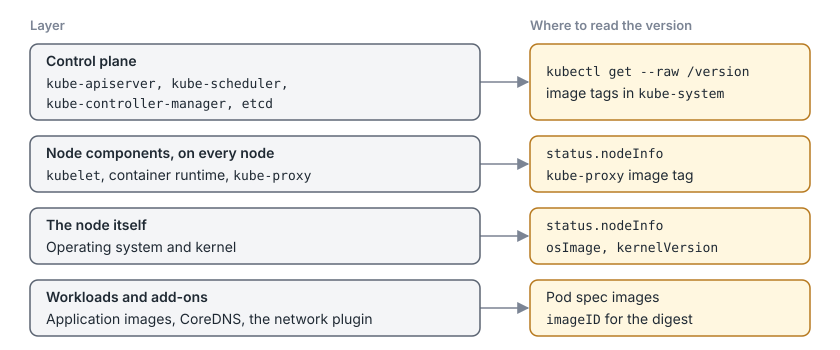
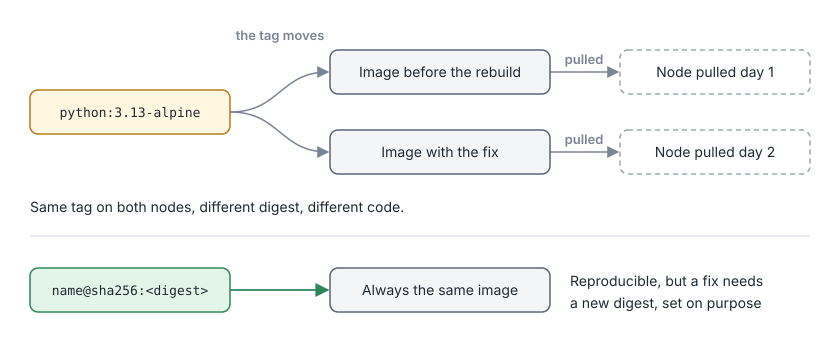

# Inventory What The Cluster Runs

A vulnerability record names versions. To compare, you need a list of what runs in your cluster: every component, its version and where it runs. That list is a **version inventory**.

On this page, you build an inventory from a live cluster with `kubectl` only. You also see why the tag in an image name is not enough to identify the code inside the image.

## The layers of a cluster

A cluster has four layers, and each layer is patched separately:

- **The control plane.** The components `kube-apiserver`, `kube-controller-manager`, `kube-scheduler` and `etcd` run as containers on the control-plane node in a `kubeadm` cluster.
- **The node components.** The `kubelet`, the container runtime and `kube-proxy` run on every node.
- **The node itself.** Each node has an operating system and a kernel.
- **The workloads.** The workloads have images, and the cluster often has add-ons such as DNS and a network plugin.

Each layer has its own version number and its own source of vulnerability records. The inventory therefore has one row for each layer and each node.



The drawing shows the four layers on the left and where you read each version on the right. The rest of this page reads them one by one.

## Read the nodes

Start with the nodes. Every node object has a `status.nodeInfo` section, and the kubelet fills it in. It holds the kubelet version, the container runtime and its version, the operating system image, the kernel version and the architecture. The command below prints a table with these fields for every node.

<!-- astrona:playground:renew -->

```sh
kubectl get nodes -o custom-columns=NAME:.metadata.name,KUBELET:.status.nodeInfo.kubeletVersion,RUNTIME:.status.nodeInfo.containerRuntimeVersion,OS:.status.nodeInfo.osImage,KERNEL:.status.nodeInfo.kernelVersion
```

In a healthy cluster, the `KUBELET` column shows the same value on all three nodes. In a cluster that is halfway through an upgrade, it shows two values, and the inventory must say which node has which.

The `RUNTIME` column has the form `containerd://` followed by the version. The node containers of `kind` share the kernel of the host that runs them. So the `KERNEL` column shows the host kernel, not a kernel of the node itself.

## Read the control-plane components

Next come the control-plane components. In a `kubeadm` cluster, they run as static Pods in the namespace `kube-system`. A **static Pod** is a Pod that the kubelet starts from a manifest file on the node, not from the API server. The image tag of each Pod is the version of that component. This command prints each Pod name and its images:

```sh
kubectl -n kube-system get pods -o custom-columns=NAME:.metadata.name,IMAGE:.spec.containers[*].image
```

The Pods `kube-apiserver`, `kube-controller-manager`, `kube-scheduler` and `kube-proxy` show Kubernetes version tags. The `etcd` and `coredns` Pods show their own version numbers, and the Pod of the network plugin shows the version of the plugin.

Record each one with the name of the component, not only the image name. A CVE for CoreDNS is matched against the CoreDNS version, not against the Kubernetes version.

## Read the workload images

The workload images live in every namespace. The next command prints the namespace, the Pod name and the container images for all Pods in the cluster:

```sh
kubectl get pods -A -o jsonpath='{range .items[*]}{.metadata.namespace}{"\t"}{.metadata.name}{"\t"}{range .spec.containers[*]}{.image}{" "}{end}{"\n"}{end}'
```

Use this list to find old images, images that use the tag `latest`, and images from a registry that you do not control. The output includes the system Pods too, so you can filter it by namespace.

## A tag is not an identity

The list shows image names with tags, but a tag does not tell you the exact code. The tag `python:3.13-alpine` names a moving target. The image registry can point the same tag at a new image tomorrow, after a rebuild that includes a security fix. Two nodes that pulled the tag on different days can then run different code under the same name.

A **digest** is the SHA-256 hash of the image content, written as `sha256:` followed by 64 hexadecimal characters. A digest never changes for one image.



The drawing shows how one tag can lead to two different images, while a digest always names one image.

The container runtime records the digest of the image that each running container uses. Read it from the Pod status of the Deployment `probe`:

```sh
kubectl -n starfleet get pods -l app=probe -o jsonpath='{range .items[*]}{.metadata.name}{"\t"}{.status.containerStatuses[0].imageID}{"\n"}{end}'
```

The `imageID` field shows the digest. When the node pulled the image from a registry, the field shows the image name and the registry digest (`name@sha256:...`). When the image was loaded into the node without a pull, the field shows only `sha256:` and the ID of the image. Two replicas that show different digests run different code.

To pin a workload to exact content, write the image as `name@sha256:<digest>` in the Deployment. A pinned digest is reproducible, but it also stops the workload from picking up fixes by itself. The team must then update the digest on purpose.

## Scan the images

An inventory lists versions, but it does not say which flaws an image contains. A scanner does that. It compares the content of an image with a database of known vulnerabilities and prints the matches. Trivy is a common open source scanner.

The command below scans one image and shows only the findings rated High or Critical. It needs the `trivy` tool and network access, so it is shown for you to read and is not run in the playground:

```sh
trivy image --severity HIGH,CRITICAL registry.k8s.io/kube-apiserver:v1.35.0
```

A scan has limits. It reports only what its database knows, and it can report a flaw in a library that the program never calls. Treat the output as a list of findings to triage, not as a final answer.

## Keep the record

Now write the result into the cluster, so that anyone can read it and a script can compare it later. Replace the values in angle brackets with what you read above. The server version comes from `kubectl get --raw /version`. Save this as `configmap-scratch-inventory.yaml`:

```yaml
apiVersion: v1
kind: ConfigMap
metadata:
  name: scratch-inventory
  namespace: starfleet
data:
  server-version: <SERVER_VERSION>
  kubelet-control-plane: <KUBELET_CONTROL_PLANE>
  probe-image: <PROBE_IMAGE>
```

Apply it:

```sh
kubectl apply -f configmap-scratch-inventory.yaml
```

Then check the result with `kubectl -n starfleet get configmap scratch-inventory -o yaml`. A ConfigMap is a simple place for a small record. A larger team keeps the inventory in a database or an asset tool, and a job fills it by running the same commands. Remove the object with `kubectl -n starfleet delete configmap scratch-inventory` when you finish.

You can now say what each node and component runs and which image content a Pod uses. The open question is what to do first when a vulnerability matches your inventory.

## Common pitfalls

> [!WARNING]
> - **Recording the image tag as if it were the content.** A tag can move; a digest cannot.
> - **Assuming all nodes run the same kubelet.** During an upgrade, they differ, and the inventory must list each node.
> - **Forgetting the layers outside Kubernetes.** The operating system, the kernel and the container runtime have their own flaws.
> - **Treating `etcd` and `coredns` tags as Kubernetes versions.** They are separate projects with their own version numbers.
> - **Trusting a scan result without reading it.** A finding may not apply, and a clean scan does not prove that there are no flaws.
