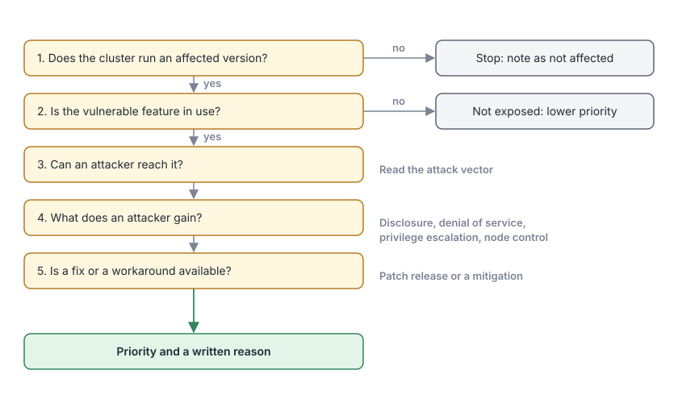
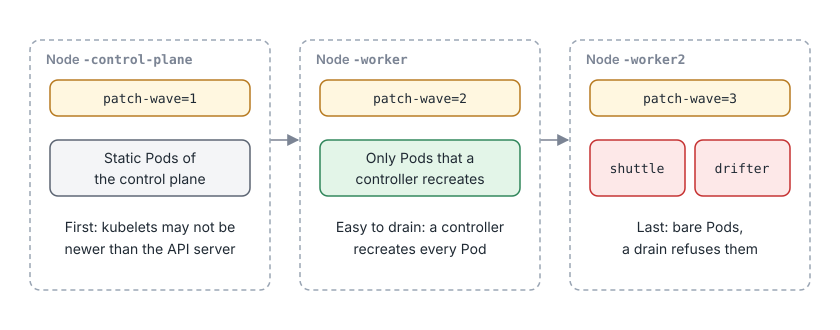

# Triage A Vulnerability And Plan Patch Waves

A new vulnerability record arrives, and your version inventory is ready. Now you must decide how fast to act and in which order. **Triage** is the step that sorts findings by their real risk. It keeps the team from treating every finding as an emergency, and it keeps the team from ignoring the one that matters.

On this page, you learn a method for triage and apply it to an example. Then you record the order of the nodes in the playground cluster.

## Five questions

Triage works best when you ask the same questions every time. Ask these five questions for every record, in this order:

1. **Does the cluster run an affected version?** Compare the component version in the inventory with the affected and fixed lists of the record. If the answer is no, stop and note the finding as not affected.
2. **Is the vulnerable feature in use?** Some flaws exist only in an optional feature, such as a flag, an API or a volume type. A cluster that does not enable that feature is not exposed.
3. **Can an attacker reach it?** Read the vector. A flaw in the API server is reachable by every client that can open a connection to it. A flaw in the kubelet needs access to the kubelet port or to a Pod on that node. A flaw in a workload is reachable only through the Service of that workload.
4. **What does an attacker gain?** Information disclosure, denial of service, privilege escalation and control of a node have very different results.
5. **Is a fix or a workaround available?** A patch release is the fix. Some records also give a mitigation that reduces the risk until the upgrade, such as disabling a feature or blocking a port with a NetworkPolicy.



The drawing shows the questions as a flow. The first two can end the check early, and the last three set how high the priority is.

The answers give a priority. A flaw that is reachable, has a high impact and has a fix available gets fixed within days. A Low flaw in a feature you do not use goes into the next planned upgrade.

## An example

The method is easier to follow with a real case. Take a made-up record: a flaw in the kubelet, rated High, fixed in `v1.35.2`. A user who can create a Pod on a node can use it. The inventory shows kubelet `v1.35.0` on three nodes.

Now walk through the five answers:

1. Yes, the cluster is affected.
2. The feature is the core Pod start path, so it is in use.
3. The attacker needs the right to create Pods, and many teams hold that right.
4. The attacker gains control of a node.
5. A fix exists.

The priority is high, and the plan is a patch upgrade of every node.

Now change one fact. Say the record needs the right to create `hostPath` volumes, and the cluster rejects `hostPath` volumes with an admission rule. The attacker cannot meet the condition, so the finding drops in priority. The upgrade still happens, but in the next window and not at once. The record must say why the priority is lower, so that a later reader can check the reasoning.

## Decide the patch waves

A high priority tells you when to start, but not which node goes first. A **patch wave** is a group of nodes that you upgrade in the same step. The upgrade rules decide the order:

- The control plane goes first, because kubelets may not be newer than the API server.
- Workers follow one at a time or in small groups, so the application keeps enough capacity.
- Nodes that are harder to drain go last, because they need extra preparation. A node that runs bare Pods, or a Pod with a volume that attaches to only one node, is harder to drain.

A bare Pod is a Pod that no controller owns, so nothing recreates it when you remove it from a node.

In the playground, the control-plane node is wave 1. The first worker runs only Pods that a controller recreates, so it is wave 2. The second worker runs the bare Pods `shuttle` and `drifter`, which a drain refuses to remove, so it is wave 3.



The drawing shows the three nodes in wave order and why each one has its place.

Check this in the cluster. Read which Pods run on the second worker, then list the owner of every Pod to find the Pods that have none:

<!-- astrona:playground:renew -->

```sh
kubectl get pods -A -o wide --field-selector spec.nodeName=astro-ats-032-playground-040-02-worker2
kubectl get pods -A -o custom-columns=NAMESPACE:.metadata.namespace,NAME:.metadata.name,OWNER:.metadata.ownerReferences[0].kind
```

The `OWNER` column shows `<none>` for a bare Pod. For a Pod that a controller owns, it names the controller kind, such as `ReplicaSet`, `DaemonSet` or `Node`. The static Pods of the control plane show `Node`. The bare Pods are the ones to handle before the turn of their node.

## Record the order on the nodes

You now know the order, but it should not live only in your head. A label on the node object keeps the plan next to the thing it describes. A label is a key and value pair that tools can select on. Apply a `patch-wave` label to the three nodes:

```sh
kubectl label node astro-ats-032-playground-040-02-control-plane patch-wave=1
kubectl label node astro-ats-032-playground-040-02-worker patch-wave=2
kubectl label node astro-ats-032-playground-040-02-worker2 patch-wave=3
```

Then list the nodes with the label as a column, and select the nodes of one wave:

```sh
kubectl get nodes -L patch-wave
kubectl get nodes -l patch-wave=2
```

The first command shows the wave next to each node. The second command prints the single node of wave 2. A maintenance script can loop over the `patch-wave` values in order, so the plan becomes data that a tool can read. Remove the labels with `kubectl label node <name> patch-wave-` when you are done with the practice.

## Write the decision down

The labels record the order, and the decision itself needs a record too. For each vulnerability record, keep four lines:

- the identifier;
- the affected component and its version in the cluster;
- the decision with its reason;
- the planned date.

When the upgrade is done, add the verified version. This turns a security process into evidence. An auditor can then check that a Critical record with a reachable vector was handled within days, and that a Low record was handled in a planned window.

You can now go from an announcement to an ordered plan. The inventory says what is affected, the five questions say how urgent it is, and the wave labels say in which order the nodes change. What is still open is the upgrade itself, which follows the plan wave by wave.

## Common pitfalls

> [!WARNING]
> - **Treating every record as an emergency.** Triage by reachability and impact, or the team stops listening.
> - **Closing a record without a reason.** Write down why the finding has a lower priority, so a reader can check it.
> - **Ordering waves by node name.** Put the control plane first, then order the workers by how hard they are to drain.
> - **Forgetting bare Pods.** A drain refuses them, so handle them before the wave of their node.
> - **Keeping the plan only in a document.** Scripts can read labels and records that live in the cluster.
