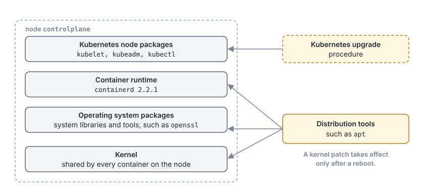
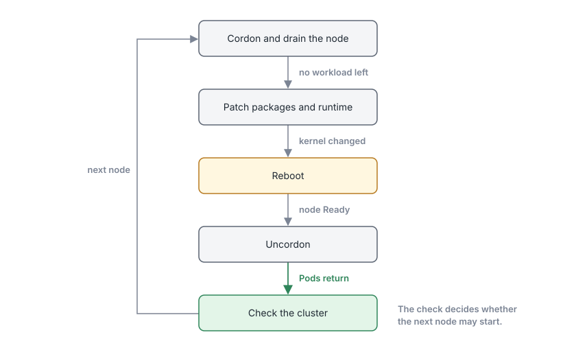
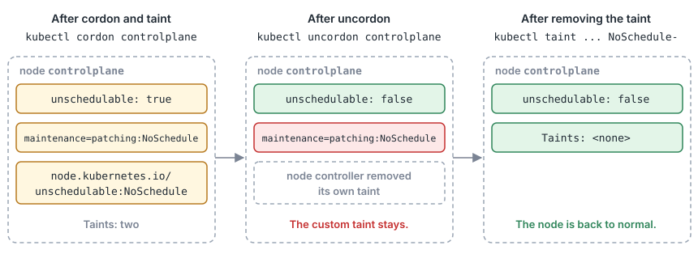
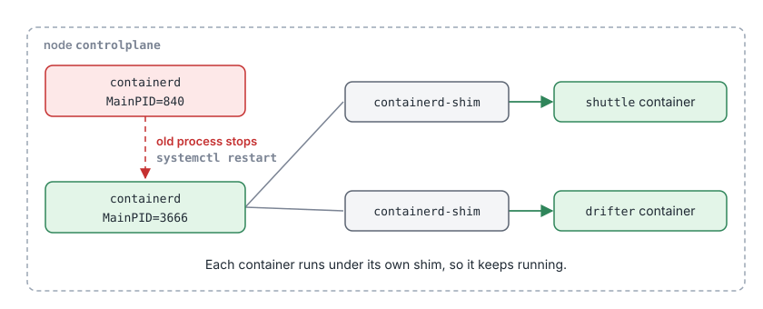

# Patch The Operating System And Container Runtime On Nodes

The `kubelet` and the control-plane components are only part of a node. Below them run the operating system, the kernel and the container runtime, and attackers use flaws in all three. A Kubernetes upgrade does not fix any of them.

On this page, you learn what to patch on a node and the routine that keeps the application available while you do it. You also see the leftovers that a maintenance window can leave behind, and how to remove them.

## What lives on a node

A node is a host with four layers that need patches:

- The **operating system packages** include system libraries and tools such as `openssl`.
- The **kernel** is the core of the operating system. Every container on the node shares it, so a kernel flaw can let a process escape its container.
- The **container runtime** starts and stops containers. In most clusters it is `containerd`.
- The **Kubernetes node packages** are `kubelet`, `kubeadm` and `kubectl`.

You patch the first three layers with the tools of the Linux distribution. You patch the last layer with the Kubernetes upgrade procedure. A security policy has to cover both groups. A cluster with a perfect Kubernetes version can still be taken over through an old kernel.



The drawing shows the four layers of the `controlplane` node and which routine patches each of them.

## Read what a node runs

Before you patch anything, you need to know what the node runs now. The node object shows the operating system image, the kernel and the runtime version. Read them for every node before and after a patch, so that the change is visible. On the host, `uname -r` prints the running kernel, and `containerd --version` prints the version of the runtime program:

<!-- astrona:playground:renew -->

```sh
kubectl get nodes -o custom-columns=NAME:.metadata.name,OS:.status.nodeInfo.osImage,KERNEL:.status.nodeInfo.kernelVersion,RUNTIME:.status.nodeInfo.containerRuntimeVersion
uname -r
containerd --version
```

```text
NAME           OS                   KERNEL              RUNTIME
controlplane   Ubuntu 24.04.5 LTS   6.8.0-149-generic   containerd://2.2.1
6.8.0-149-generic
containerd github.com/containerd/containerd/v2 2.2.1
```

The `kubelet` reports the same kernel and runtime that the host shows. Compare each value with the fixed version in a security advisory. Note that the kernel version changes only after a reboot. So a node with a patched kernel package can still run the old kernel: the package is new, but the running kernel is the one that booted.

## The rotation

Now that you can read the versions, you need a safe order of steps. The safe routine patches one node at a time, in the order of the patch waves. It repeats the same steps for each node:



The drawing shows the order of the steps within one node. The check at the end decides whether the next node may start.

On Debian or Ubuntu hosts, the package manager `apt` patches the packages. Four commands show the state before a patch:

- `apt-get update` reads the package lists.
- `apt-mark showhold` lists the packages that are held at their version.
- `apt-get upgrade --simulate` prints what an upgrade would change, without changing anything.
- The last line checks for the reboot marker file.

```sh
sudo apt-get update
apt-mark showhold
sudo apt-get upgrade --simulate
test -f /var/run/reboot-required && echo reboot needed
```

The output of `apt-get update` is a list of package sources, and it is left out here. If the VM has no network, it only prints warnings, and the simulation uses the lists it already has. The rest of the output below comes from one run on 2026-11-24, when the VM could reach the Ubuntu mirror.

The four held packages are the same on every run. They are the three Kubernetes packages and `falco`, a runtime security tool that watches system calls, which the image holds at its version. The list of upgrades is not the same. It depends on the updates published since the image was built and on whether the VM can reach the mirror, so your list will differ.

```text
falco
kubeadm
kubectl
kubelet
Reading package lists...
Building dependency tree...
Reading state information...
Calculating upgrade...
The following upgrades have been deferred due to phasing:
  libsqlite3-0
The following packages will be upgraded:
  libssh-4 python3-oauthlib
2 upgraded, 0 newly installed, 0 to remove and 1 not upgraded.
Inst libssh-4 [0.10.6-2ubuntu0.5] (0.10.6-2ubuntu0.6 Ubuntu:24.04/noble-updates, Ubuntu:24.04/noble-security [amd64])
Inst python3-oauthlib [3.2.2-1] (3.2.2-1ubuntu0.1 Ubuntu:24.04/noble-updates, Ubuntu:24.04/noble-security [all])
Conf libssh-4 (0.10.6-2ubuntu0.6 Ubuntu:24.04/noble-updates, Ubuntu:24.04/noble-security [amd64])
Conf python3-oauthlib (3.2.2-1ubuntu0.1 Ubuntu:24.04/noble-updates, Ubuntu:24.04/noble-security [all])
```

Ubuntu releases some updates in phases: at first, only part of all machines get the new version. `apt` defers such a phased update on the other machines. That is why `libsqlite3-0` is listed as deferred and counted as "not upgraded". The held packages stay on their version during `apt-get upgrade`, and the kubeadm upgrade procedure moves the three Kubernetes packages.

The last command printed nothing, because the marker file `/var/run/reboot-required` does not exist. Ubuntu creates this file after a kernel or core library update. When it exists, you run `sudo systemctl reboot` on the drained node. After the reboot, the `kubelet` starts again and the node becomes Ready.

Some teams skip patching in place. They create a new node from a newer image, add it to the cluster, drain the old node and delete it. This is called node replacement. It gives the same result as patching, and the nodes stay identical, but it needs automation that creates nodes.

## Automatic reboots

Patching by hand works, but many teams automate it. Unattended security updates install patches without a person. They work well for packages, but a kernel update still needs a reboot. An unplanned reboot takes down every Pod on the node at once.

A reboot controller such as Kured solves this. It watches for the reboot marker file and takes a lock, so that only one node reboots at a time. Then it drains the node, reboots it and uncordons it. Whatever tool you use, the rules are the same: one node at a time, drained first, and a disruption budget in place.

## Practise the maintenance state

A window puts a node into states that you can see with `kubectl`. One of them is a taint. A taint is a key, a value and an effect on a node, and it keeps Pods away unless they tolerate it. The effect `NoSchedule` stops new Pods from being placed on the node and keeps the running ones.

Cordon the node and add a taint:

```sh
kubectl cordon controlplane
kubectl taint nodes controlplane maintenance=patching:NoSchedule
kubectl get nodes
kubectl describe node controlplane | grep -i -A2 taints
```

```text
node/controlplane cordoned
node/controlplane tainted
NAME           STATUS                     ROLES           AGE   VERSION
controlplane   Ready,SchedulingDisabled   control-plane   33s   v1.35.10
Taints:             maintenance=patching:NoSchedule
                    node.kubernetes.io/unschedulable:NoSchedule
Unschedulable:      true
```

The node shows `Ready,SchedulingDisabled`. `kubectl cordon` sets the field `unschedulable` on the node. The node controller then adds its own taint, named `node.kubernetes.io/unschedulable`, so the description lists both taints.

Now undo the work in two steps, and look at the result after the first step:

```sh
kubectl uncordon controlplane
kubectl describe node controlplane | grep -i -A2 taints
```

```text
node/controlplane uncordoned
Taints:             maintenance=patching:NoSchedule
Unschedulable:      false
Lease:
```

The node is schedulable again, but the taint `maintenance=patching:NoSchedule` is still there. `kubectl uncordon` clears only the unschedulable flag, and the node controller then removes its own taint. A new Pod that does not tolerate the custom taint still cannot run on the node. Remove the taint with a minus sign at the end:

```sh
kubectl taint nodes controlplane maintenance=patching:NoSchedule-
kubectl describe node controlplane | grep -i -A2 taints
```

```text
node/controlplane untainted
Taints:             <none>
Unschedulable:      false
Lease:
```



The drawing shows the three states of the node. Uncordon clears the cordon, and only the `kubectl taint` command with a minus sign clears the custom taint.

The node is back to normal. The next step is to empty a node before you change its runtime.

## Drain the node and restart the runtime

`kubectl drain` cordons the node, and then it asks the API server to evict each Pod on it. An eviction is a delete that respects disruption budgets. The controller of each Pod, for example the ReplicaSet of a Deployment, then creates a replacement Pod. The option `--ignore-daemonsets` skips Pods of a DaemonSet, such as `kube-proxy`, because their controller would put them straight back:

```sh
kubectl drain controlplane --ignore-daemonsets
kubectl get nodes
```

```text
node/controlplane cordoned
error: unable to drain node "controlplane" due to error: cannot delete cannot delete Pods that declare no controller (use --force to override): outpost/drifter, starfleet/shuttle, continuing command...
There are pending nodes to be drained:
 controlplane
cannot delete cannot delete Pods that declare no controller (use --force to override): outpost/drifter, starfleet/shuttle
NAME           STATUS                     ROLES           AGE   VERSION
controlplane   Ready,SchedulingDisabled   control-plane   38s   v1.35.10
```

The drain stopped with exit code 1 and evicted nothing. `shuttle` and `drifter` are bare Pods: no controller would create them again. So `kubectl` refuses to delete them unless you add `--force`, and then they are gone for good. The node stays cordoned. In a real window, you give such Pods a controller or accept their loss.

In this playground, keep the client Pods and drain only the `probe` Pods. The option `--pod-selector` limits the drain to Pods with a matching label:

```sh
kubectl drain controlplane --ignore-daemonsets --pod-selector=app=probe --timeout=120s
kubectl get pods -A -o wide --field-selector=metadata.namespace!=kube-system
```

```text
node/controlplane already cordoned
evicting pod starfleet/probe-7db6ffd7d6-cbghl
evicting pod starfleet/probe-7db6ffd7d6-98rng
pod/probe-7db6ffd7d6-cbghl evicted
pod/probe-7db6ffd7d6-98rng evicted
node/controlplane drained
NAMESPACE   NAME                     READY   STATUS    RESTARTS   AGE   IP           NODE           NOMINATED NODE   READINESS GATES
outpost     drifter                  1/1     Running   0          56s   10.244.0.7   controlplane   <none>           <none>
starfleet   probe-7db6ffd7d6-9sdkb   0/1     Pending   0          31s   <none>       <none>         <none>           <none>
starfleet   probe-7db6ffd7d6-wjxpv   0/1     Pending   0          31s   <none>       <none>         <none>           <none>
starfleet   shuttle                  1/1     Running   0          57s   10.244.0.6   controlplane   <none>           <none>
```

The ReplicaSet created two new `probe` Pods. They stay `Pending`, because the scheduler has no node where it may place them. In a cluster with several nodes, they would start on another node. That is why you patch one node of several at a time.

Now restart the runtime. `systemd` is the service manager of Ubuntu, and `systemctl` is the command that talks to it. Read the process ID (`MainPID`) and the start time before and after the restart, so that you can prove the restart happened. Then wait for the node to be Ready, uncordon it and wait for the Deployment:

```sh
systemctl show containerd --property=MainPID --property=ActiveEnterTimestamp
sudo systemctl restart containerd
systemctl is-active containerd
systemctl show containerd --property=MainPID --property=ActiveEnterTimestamp
kubectl -n starfleet get pod shuttle
kubectl wait --for=condition=Ready node/controlplane --timeout=180s
kubectl uncordon controlplane
kubectl -n starfleet rollout status deployment/probe --timeout=180s
kubectl -n starfleet get pods -o wide
```

```text
MainPID=840
ActiveEnterTimestamp=Wed 2026-11-18 09:02:40 UTC
active
MainPID=3666
ActiveEnterTimestamp=Wed 2026-11-18 09:04:02 UTC
NAME      READY   STATUS    RESTARTS   AGE
shuttle   1/1     Running   0          57s
node/controlplane condition met
node/controlplane uncordoned
Waiting for deployment "probe" rollout to finish: 0 of 2 updated replicas are available...
Waiting for deployment "probe" rollout to finish: 1 of 2 updated replicas are available...
deployment "probe" successfully rolled out
NAME                     READY   STATUS    RESTARTS   AGE   IP           NODE           NOMINATED NODE   READINESS GATES
probe-7db6ffd7d6-9sdkb   1/1     Running   0          32s   10.244.0.9   controlplane   <none>           <none>
probe-7db6ffd7d6-wjxpv   1/1     Running   0          32s   10.244.0.8   controlplane   <none>           <none>
shuttle                  1/1     Running   0          58s   10.244.0.6   controlplane   <none>           <none>
```

`containerd` has a new process ID and a later start time, so the new program runs. `shuttle` kept running with zero restarts. Each container runs under its own `containerd-shim` process, so a restart of the runtime does not stop running containers. As soon as the node was uncordoned, the scheduler placed the two `Pending` Pods on it.



The drawing shows why `shuttle` survived: `systemctl` replaced only the `containerd` process, and the shim processes kept the containers running.

That does not make the drain optional. A runtime that fails to start again leaves every Pod on the node without a working runtime. A reboot after a kernel patch also stops every container on the node.

You can now patch a node without surprises. You read its versions, simulate the upgrade, drain it, restart the runtime or reboot, and return it to service. A window can still leave a cordon, a taint or a stuck Pod behind, and the open question is how to find these leftovers every time.

## Common pitfalls

> [!WARNING]
> - **Patching the kernel and not rebooting.** The package is new, but the running kernel is still the old one.
> - **Rebooting a node that was not drained.** Every Pod on it stops at once.
> - **Patching all nodes in one window step.** The application loses all its capacity at the same time.
> - **Running `kubectl uncordon` and expecting the node to be normal.** A custom taint stays until you remove it.
> - **Adding `--force` to a drain without reading the list.** Bare Pods that `--force` deletes do not come back.
> - **Letting a system update upgrade held Kubernetes packages.** Keep the hold, and upgrade them with the upgrade procedure.
