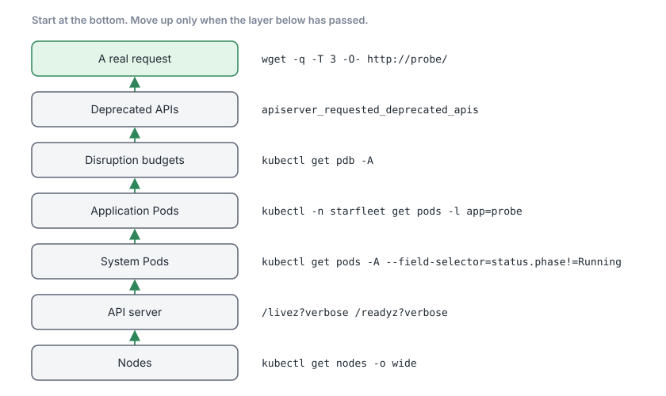
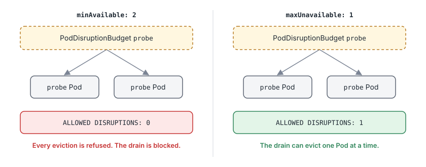

# Verify The Cluster After An Upgrade

After an upgrade or a patch window, the commands have succeeded and the cluster looks quiet. That is not proof. A node can stay cordoned, a Pod can wait for a place to run, and a budget can block the next drain, all without an error message.

On this page, you build a layered check. It goes from the nodes up to a real request, so that each layer is proven before you trust the next one.

## Why the order matters

A failure at a lower layer causes confusing failures above it. If a node is `NotReady`, the Pods on it look broken. If the API server is not healthy, every `kubectl` answer is suspect. So the check starts at the bottom, and a failed layer stops the check until you fix it.

The check has these layers, from the bottom up:

- the nodes;
- the control plane;
- the system Pods;
- the application Pods;
- the disruption budgets;
- the use of deprecated APIs;
- a request that goes through the whole path.

Every layer has a command that reads the cluster and changes nothing.



The drawing shows the layers and the command that reads each one. You move up only when the layer below has passed.

## Nodes and the API server

The check starts with the nodes. Every node must be `Ready`, with no `SchedulingDisabled` mark, and it must show the target version. Then the API server must report that it is alive and ready:

- The endpoint `/livez` says whether the API server process is alive.
- The endpoint `/readyz` says whether it can serve requests.
- The `verbose` option lists each internal check.

<!-- astrona:playground:renew -->

```sh
kubectl get nodes -o wide
kubectl get --raw='/livez?verbose'
kubectl get --raw='/readyz?verbose'
```

The output below is shortened. The API server prints about thirty checks, most of them named `poststarthook/...`, and only the first lines and the last line of `/livez` are shown.

```text
NAME           STATUS   ROLES           AGE   VERSION    INTERNAL-IP   EXTERNAL-IP   OS-IMAGE             KERNEL-VERSION      CONTAINER-RUNTIME
controlplane   Ready    control-plane   84s   v1.35.10   10.0.2.15     <none>        Ubuntu 24.04.5 LTS   6.8.0-149-generic   containerd://2.2.1
[+]ping ok
[+]log ok
[+]etcd ok
...
livez check passed
```

The `/readyz` list has the same checks plus a few more, for example `etcd-readiness`, `informer-sync` and `shutdown`. It ends with `readyz check passed`. A failing check starts with `[-]` instead of `[+]`, and the last line then says that the check failed. In a cluster with several control-plane nodes, run the check against each API server, not only against a load balancer.

## System and application Pods

With the nodes and the API server proven, the next layer is the Pods. The system Pods in `kube-system` run DNS, the network plugin and the proxy. If they are not ready, application Pods fail in ways that look like application bugs. List every Pod that is not in the `Running` phase in any namespace, then the Pods of the application:

```sh
kubectl get pods -A --field-selector=status.phase!=Running
kubectl -n starfleet get pods -l app=probe
```

```text
No resources found
NAME                     READY   STATUS    RESTARTS   AGE
probe-7db6ffd7d6-9sdkb   1/1     Running   0          40s
probe-7db6ffd7d6-wjxpv   1/1     Running   0          40s
```

Nothing is outside the `Running` phase, so this cluster passes. A Pod in the `Pending` phase has not been placed on a node yet. To see what that looks like, create one on purpose. Add a taint to the node and scale the Deployment to three replicas, so that the ReplicaSet must create a new Pod:

```sh
kubectl taint nodes controlplane maintenance=patching:NoSchedule
kubectl -n starfleet scale deployment probe --replicas=3
kubectl -n starfleet get pods -l app=probe
```

```text
node/controlplane tainted
deployment.apps/probe scaled
NAME                     READY   STATUS    RESTARTS   AGE
probe-7db6ffd7d6-8qnt6   0/1     Pending   0          5s
probe-7db6ffd7d6-9sdkb   1/1     Running   0          45s
probe-7db6ffd7d6-wjxpv   1/1     Running   0          45s
```

The two old Pods keep running, because `NoSchedule` affects only new Pods. The new Pod stays `Pending`. The scheduler writes the reason into the events of the Pod, so read them with `describe`. Use the Pod name from your own output:

```sh
kubectl -n starfleet describe pod probe-7db6ffd7d6-8qnt6 | sed -n '/^Events:/,$p'
```

```text
Events:
  Type     Reason            Age   From               Message
  ----     ------            ----  ----               -------
  Warning  FailedScheduling  12s   default-scheduler  0/1 nodes are available: 1 node(s) had untolerated taint(s). no new claims to deallocate, preemption: 0/1 nodes are available: 1 Preemption is not helpful for scheduling.
```

The scheduler checked one node and rejected it, because the node has a taint that the Pod does not tolerate. The message names the reason for each rejected node, and each common leftover of a window has its own text:

- A cordoned node gives `node(s) were unschedulable`.
- A required pod anti-affinity rule gives `didn't match pod anti-affinity rules`. This rule (`requiredDuringSchedulingIgnoredDuringExecution` with a `topologyKey` such as `kubernetes.io/hostname`) says that two Pods with the same label must not run on the same node.
- A spread rule (`topologySpreadConstraints` with `whenUnsatisfiable: DoNotSchedule`) can block a Pod in the same way.

The anti-affinity case often appears during a drain. When a drain leaves one node fewer, a Deployment with this rule can have more replicas than free nodes. The extra replicas then stay `Pending` until a node returns.

Now remove the taint, wait for the third Pod and scale back to two replicas:

```sh
kubectl taint nodes controlplane maintenance=patching:NoSchedule-
kubectl -n starfleet rollout status deployment/probe --timeout=120s
kubectl -n starfleet scale deployment probe --replicas=2
```

```text
node/controlplane untainted
Waiting for deployment "probe" rollout to finish: 2 of 3 updated replicas are available...
deployment "probe" successfully rolled out
deployment.apps/probe scaled
```

The Pending Pod started as soon as the taint was gone. The fix is always on the cause: the node, the taint or the rule. Deleting the Pending Pod does not help, because the ReplicaSet creates a new one with the same problem.

## Disruption budgets

The Pods run, but the next window also needs them to move. A PodDisruptionBudget (PDB) is an object that limits how many Pods of an application a voluntary eviction, such as a drain, may remove at the same time. The API server enforces it when `kubectl drain` asks for an eviction. A budget that allows no disruption does not break anything today, but it blocks the next drain.

Save this as `poddisruptionbudget-probe.yaml`:

```yaml
apiVersion: policy/v1
kind: PodDisruptionBudget
metadata:
  name: probe
  namespace: starfleet
spec:
  minAvailable: 2
  selector:
    matchLabels:
      app: probe
```

Apply it:

```sh
kubectl apply -f poddisruptionbudget-probe.yaml
```

```text
poddisruptionbudget.policy/probe created
```

Then check the result:

```sh
kubectl get pdb -A
```

```text
NAMESPACE   NAME    MIN AVAILABLE   MAX UNAVAILABLE   ALLOWED DISRUPTIONS   AGE
starfleet   probe   2               N/A               0                     3s
```

`ALLOWED DISRUPTIONS` is the number of evictions that the API server permits right now. It is 0, because the budget asks for two available Pods and the Deployment has exactly two. A drain of this node now fails. `kubectl drain` repeats the message `Cannot evict pod as it would violate the pod's disruption budget.` and gives up when its `--timeout` ends.

A value of 0 has two common causes. Either the budget asks for as many Pods as exist, or fewer Pods are ready than the budget needs. Fix the cause before you leave the window.

Here the cause is the budget itself. A budget with `maxUnavailable: 1` says the same thing in a way that keeps working at any replica count. Replace the content of `poddisruptionbudget-probe.yaml` with this version:

```yaml
apiVersion: policy/v1
kind: PodDisruptionBudget
metadata:
  name: probe
  namespace: starfleet
spec:
  maxUnavailable: 1
  selector:
    matchLabels:
      app: probe
```

Apply it again and read the budget:

```sh
kubectl apply -f poddisruptionbudget-probe.yaml
kubectl get pdb -A
```

```text
poddisruptionbudget.policy/probe configured
NAMESPACE   NAME    MIN AVAILABLE   MAX UNAVAILABLE   ALLOWED DISRUPTIONS   AGE
starfleet   probe   N/A             1                 1                     36s
```

Now one eviction is allowed, so a drain can move the Pods one at a time. The column `ALLOWED DISRUPTIONS` must be at least 1 for every budget that protects an application with more than one replica.



The drawing compares the two budgets for the same two `probe` Pods. Only the `maxUnavailable: 1` budget lets the drain evict a Pod.

## Deprecated APIs and a real request

The last two layers look at the clients of the cluster. Kubernetes removes old API versions in later releases. A workload or a tool that still calls a removed version fails after the upgrade that removes it. The API server counts these calls in a metric named `apiserver_requested_deprecated_apis`.

After that, one request through the Service proves the path that users take: a Service name, the cluster DNS, the network and a Pod. Run both checks, and read the warning events of the cluster too:

```sh
kubectl get --raw /metrics | grep apiserver_requested_deprecated_apis
kubectl -n starfleet exec shuttle -- wget -q -T 3 -O- http://probe/
kubectl get events -A --field-selector type=Warning
```

The event list below is shortened to the first four lines. The rest were more `FailedScheduling` events of the `probe` Pods.

```text
# HELP apiserver_requested_deprecated_apis [STABLE] Gauge of deprecated APIs that have been requested, broken out by API group, version, resource, subresource, and removed_release.
# TYPE apiserver_requested_deprecated_apis gauge
apiserver_requested_deprecated_apis{group="",removed_release="",resource="endpoints",subresource="",version="v1"} 1
version=v1 host=probe-7db6ffd7d6-9sdkb greeting=hello
NAMESPACE     LAST SEEN   TYPE      REASON                OBJECT                            MESSAGE
default       2m30s       Warning   InvalidDiskCapacity   node/controlplane                 invalid capacity 0 on image filesystem
default       2m27s       Warning   InvalidDiskCapacity   node/controlplane                 invalid capacity 0 on image filesystem
kube-system   2m25s       Warning   Unhealthy             pod/kube-scheduler-controlplane   Readiness probe failed: HTTP probe failed with statuscode: 500
starfleet     64s         Warning   FailedScheduling      pod/probe-7db6ffd7d6-8qnt6        0/1 nodes are available: 1 node(s) had untolerated taint(s). no new claims to deallocate, preemption: 0/1 nodes are available: 1 Preemption is not helpful for scheduling.
```

The metric has one series for each deprecated API that a client called since the API server started, with the value 1. Here a client read `endpoints` in version `v1`, which Kubernetes deprecated in favour of EndpointSlices. The label `removed_release` names the release that removes the API. It is empty here, because no removal is planned.

When the label has a version, migrate the caller before that release. Run this check before the next upgrade as well, because it tells you what the next upgrade can break.

The request returned the text of one `probe` Pod, with its version, so the Service, DNS and network work. A timeout would point to the network, DNS or the Service endpoints. In a real application, send one request for each important path.

The warning events need their timestamps. The `InvalidDiskCapacity` and `Unhealthy` events are from the first minutes of the cluster, while the `kubelet` and the scheduler were still starting. The `FailedScheduling` events are from the Pending demonstration. A warning that is newer than the window and has no known cause is the one to follow.

You now have a layered check that finds the quiet failures of a window: a cordon, a taint, a scheduling rule that cannot be met, a blocking budget, a deprecated API call and a broken path. If a check fails and the fix is not clear, the open question is whether you can go back to the state before the window.

## Common pitfalls

> [!WARNING]
> - **Checking only `kubectl get nodes`.** A healthy node list does not show Pending Pods, blocked budgets or a broken application.
> - **Stopping at a green API check.** The application path needs its own request.
> - **Ignoring a budget with zero allowed disruptions.** It blocks the next window.
> - **Reading the deprecated API metric only after the upgrade.** Read it before, so that you can migrate the callers.
> - **Deleting a Pending Pod to make it go away.** The controller creates a new one that is Pending for the same reason.
