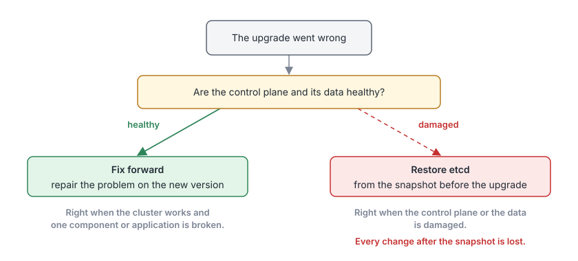
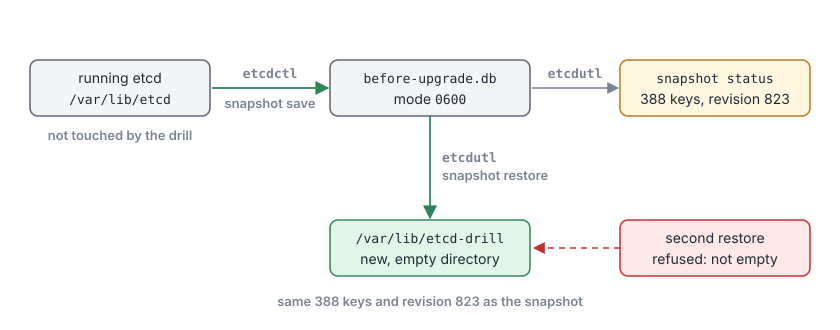
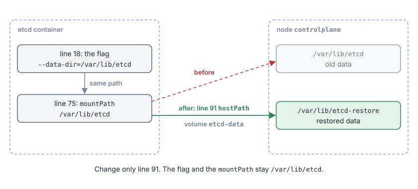

# Rollback Limits And Restore Drills

Sometimes an upgrade fails, or it succeeds and breaks an application. The natural wish is to go back. Kubernetes does not support that the way a package manager does.

On this page, you learn why there is no way back, what you can do instead, and how to prepare a restore of etcd so that it works the first time you need it. etcd is the key-value database that stores every object of the cluster.

## There is no downgrade

A control-plane upgrade changes more than programs. The API server can write objects in a newer schema to etcd, and a newer version can run storage migrations. An older API server may not be able to read what the newer one wrote. For that reason, Kubernetes does not support running a control plane of an older minor version against data that a newer one has used, and `kubeadm` has no downgrade command.

This leaves two ways out:

- **Fix forward.** You find the problem and repair it on the new version. It is the right choice when the cluster works and one component or application is broken.
- **Restore** the state from before the upgrade. You stop the control plane, put the old manifests and programs back, and restore etcd from the snapshot you took before the upgrade. It is the right choice when the control plane or the data is damaged.

A restore removes every change made after the snapshot. That is the price of this way out.



The drawing shows the decision. The health of the control plane and its data decides between fixing forward and restoring.

## Decide quickly and in writing

The decision is hard to make under stress, so agree on the rule before the window. For example: if the control plane is not healthy within a set time after the upgrade, and the cause is not known, the team restores. If the control plane is healthy and only an application fails, the team fixes forward. A written rule saves the time that a stressed team would spend arguing.

`kubeadm upgrade apply` also keeps its own copy of the static Pod manifests and the etcd data directory under `/etc/kubernetes/tmp`. It tries to roll back automatically if the upgrade fails halfway. That covers a failure inside the command. It does not cover a problem that you find an hour later.

## Check that etcd is healthy

A restore depends on a good snapshot, and a good snapshot depends on a healthy etcd. Before you take a snapshot, and again after the upgrade, ask etcd for its health and status.

In a `kubeadm` cluster, etcd runs as a static Pod. A static Pod is a Pod that the `kubelet` starts from a file on the node, not from the API server. For etcd the file is `/etc/kubernetes/manifests/etcd.yaml`, and the Pod name is `etcd-` followed by the node name.

The playground has the client tool `etcdctl` on the host. It needs three certificate options, because etcd listens on TLS (Transport Layer Security) and asks every client for a certificate. The files under `/etc/kubernetes/pki/etcd` belong to `root`, so the commands need `sudo`:

<!-- astrona:playground:renew -->

```sh
kubectl -n kube-system get pods -l component=etcd
sudo etcdctl --endpoints=https://127.0.0.1:2379 --cacert=/etc/kubernetes/pki/etcd/ca.crt --cert=/etc/kubernetes/pki/etcd/server.crt --key=/etc/kubernetes/pki/etcd/server.key endpoint health
sudo etcdctl --endpoints=https://127.0.0.1:2379 --cacert=/etc/kubernetes/pki/etcd/ca.crt --cert=/etc/kubernetes/pki/etcd/server.crt --key=/etc/kubernetes/pki/etcd/server.key endpoint status --write-out=table
```

The status table is wide. It is shortened here to its first eleven columns; the columns after `RAFT INDEX` were empty or `false`.

```text
NAME                READY   STATUS    RESTARTS   AGE
etcd-controlplane   1/1     Running   0          2m34s
https://127.0.0.1:2379 is healthy: successfully committed proposal: took = 3.703373ms
+------------------------+------------------+---------+-----------------+---------+--------+-----------------------+--------+-----------+------------+-----------+------------+
|        ENDPOINT        |        ID        | VERSION | STORAGE VERSION | DB SIZE | IN USE | PERCENTAGE NOT IN USE | QUOTA  | IS LEADER | IS LEARNER | RAFT TERM | RAFT INDEX |
+------------------------+------------------+---------+-----------------+---------+--------+-----------------------+--------+-----------+------------+-----------+------------+
| https://127.0.0.1:2379 | f074a195de705325 |   3.6.6 |           3.6.0 |  1.7 MB | 1.7 MB |                    0% | 2.1 GB |      true |      false |         2 |        865 |
+------------------------+------------------+---------+-----------------+---------+--------+-----------------------+--------+-----------+------------+-----------+------------+
```

etcd committed a test write in under 4 milliseconds, so it is healthy. The table shows etcd version 3.6.6, a database of 1.7 MB and the member ID `f074a195de705325`. This member is the leader, because it is the only member. In a cluster with several etcd members, add `--cluster` to see all of them.

## Snapshots that you can trust

With etcd healthy, you can take a snapshot. A snapshot is a single file that holds the whole etcd database at one revision. It is only useful if it exists, is recent and can be restored. Three habits make it so:

- **Take snapshots on a schedule and before every window.** A snapshot from last month loses a month of changes. A job on the control-plane host can run `etcdctl snapshot save` with a time stamp in the file name.
- **Copy them off the host.** A snapshot on the same disk is lost with that disk. A snapshot holds every Secret in the cluster, so the copy off the host needs the same protection as the Secrets: restricted access and encryption.
- **Verify each snapshot.** `etcdutl snapshot status <file>` reads the file and reports the hash, revision and size. `etcdutl` is the offline tool of etcd: it works on files and does not talk to a running server.

Take a snapshot before a pretend upgrade and verify it:

```sh
sudo mkdir -p /var/backups/etcd
sudo etcdctl --endpoints=https://127.0.0.1:2379 --cacert=/etc/kubernetes/pki/etcd/ca.crt --cert=/etc/kubernetes/pki/etcd/server.crt --key=/etc/kubernetes/pki/etcd/server.key snapshot save /var/backups/etcd/before-upgrade.db
sudo etcdutl snapshot status /var/backups/etcd/before-upgrade.db --write-out=table
sudo ls -l /var/backups/etcd
```

The output is shortened: `etcdctl` first prints six log lines in JSON format about the download, and they are left out.

```text
Snapshot saved at /var/backups/etcd/before-upgrade.db
Server version 3.6.0
+----------+----------+------------+------------+---------+
|   HASH   | REVISION | TOTAL KEYS | TOTAL SIZE | VERSION |
+----------+----------+------------+------------+---------+
| d0a983d2 |      823 |        388 |     1.7 MB |   3.6.0 |
+----------+----------+------------+------------+---------+
total 1680
-rw------- 1 root root 1716256 Nov 18 09:05 before-upgrade.db
```

The snapshot holds 388 keys at revision 823. `etcdctl` wrote the file with mode `0600`, so only `root` can read it. Keep it that way. The file contains every Secret in plain form, unless encryption at rest is on.

## Restore drills

A snapshot proves nothing until you restore it. A restore that has never been run is a guess. A drill proves that the file is complete, and it measures how long a restore takes.

`etcdutl snapshot restore` writes a new data directory from the snapshot and changes nothing else, so the running etcd is not touched. Restore into a drill directory and look at the result:

```sh
sudo etcdutl snapshot restore /var/backups/etcd/before-upgrade.db --data-dir /var/lib/etcd-drill
sudo ls -l /var/lib/etcd-drill/member
sudo etcdutl snapshot status /var/lib/etcd-drill/member/snap/db --write-out=table
```

The output is shortened: only the last log line of the restore is kept, and that line is cut after the `data-dir` field.

```text
2026-11-18T09:05:27Z	info	snapshot/v3_snapshot.go:333	restored snapshot	{"path": "/var/backups/etcd/before-upgrade.db", "wal-dir": "/var/lib/etcd-drill/member/wal", "data-dir": "/var/lib/etcd-drill", ...}
total 8
drwx------ 2 root root 4096 Nov 18 09:05 snap
drwx------ 2 root root 4096 Nov 18 09:05 wal
+----------+----------+------------+------------+---------+
|   HASH   | REVISION | TOTAL KEYS | TOTAL SIZE | VERSION |
+----------+----------+------------+------------+---------+
| 1cfa6535 |      823 |        388 |     1.7 MB |   3.6.0 |
+----------+----------+------------+------------+---------+
```

The new directory has the two folders that etcd needs. `snap` holds the database file `db`, and `wal` holds the write-ahead log, the file where etcd records each change before it applies it. The database has the same 388 keys and revision 823 as the snapshot.

The hash differs, because the restore removed the old membership data and wrote a new cluster with one member. The log of the restore names the new member ID `8e9e05c52164694d`.

`etcdutl` refuses to write into a directory that already has data. Run the same restore again:

```sh
sudo etcdutl snapshot restore /var/backups/etcd/before-upgrade.db --data-dir /var/lib/etcd-drill
```

```text
Error: data-dir "/var/lib/etcd-drill" not empty or could not be read
```

This protects you from writing over the live data directory `/var/lib/etcd` by mistake. Always restore into a new, empty directory.



The drawing shows the drill from start to end. The live directory `/var/lib/etcd` is never touched, and `etcdutl` refuses a directory that already has data.

## Point etcd at the restored data

The drill left the running etcd alone. A real restore on one control-plane node must point the etcd static Pod at the new directory. Read the lines of the manifest that name the data directory:

```sh
sudo grep -n "data-dir\|/var/lib/etcd\|etcd-data" /etc/kubernetes/manifests/etcd.yaml
```

```text
18:    - --data-dir=/var/lib/etcd
75:    - mountPath: /var/lib/etcd
76:      name: etcd-data
91:      path: /var/lib/etcd
93:    name: etcd-data
```

Three places name `/var/lib/etcd`, and they mean different things:

- Line 18 is the flag that tells etcd where its data is inside the container.
- Line 75 mounts the volume `etcd-data` at that path inside the container.
- Line 91 is the `hostPath` of the volume: the directory on the node that the container sees.

To restore, change only line 91 to the restored directory, for example `/var/lib/etcd-restore`. The container still reads `/var/lib/etcd`, but that path now shows the restored data. When the file changes, the `kubelet` stops the old etcd Pod and starts a new one.



The drawing shows how the three lines connect. Only the `hostPath` on the node side changes, and the flag and the `mountPath` inside the container stay as they are.

For a real restore, add two flags to `etcdutl snapshot restore`: `--bump-revision 1000000000 --mark-compacted`. The first raises the revision of the restored database far above any revision that clients have seen. The second marks the old revisions as compacted. Together they make the controllers in the API server and the `kubelet` start their watches again from a fresh list, instead of waiting for revisions that will never come. Without them, some controllers can keep an old view of the cluster after the restore.

With several control-plane nodes, every etcd member must start from the same snapshot. Each restore command then needs the member name and the list of initial cluster members. Practise the procedure for several nodes in a test cluster, because a mistake here splits the cluster.

After a restore, check the nodes, the API health, the system Pods, the budgets and a real request. A restored cluster returns to the time of the snapshot, so objects created after it are gone. A controller may also create or remove things to match the restored state. Compare the application against what you expect.

You now know the limits of going back and how to prepare for them: a written decision rule, a healthy etcd, verified snapshots and a restore that you have run. The open question for each cluster is how fresh its last verified snapshot is.

## Common pitfalls

> [!WARNING]
> - **Planning to downgrade the control plane.** Kubernetes does not support it; fix forward or restore etcd.
> - **Restoring because one application broke.** A restore removes every change since the snapshot; fix forward when the control plane is healthy.
> - **Leaving the only snapshot on the control-plane disk.** Copy it off the host, and protect it like a Secret.
> - **Never testing a restore.** Run a drill into a new directory before the window.
> - **Changing `--data-dir` but not the `mountPath`.** etcd then looks for its data in a path where no volume is mounted. Change only the `hostPath`.
> - **Restoring only one etcd member of several.** Every member must start from the same snapshot.
